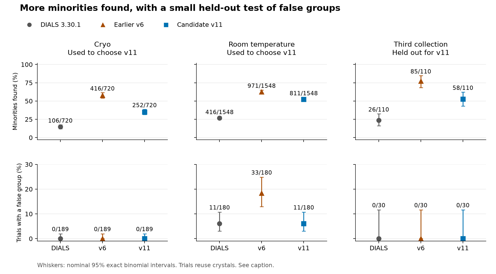
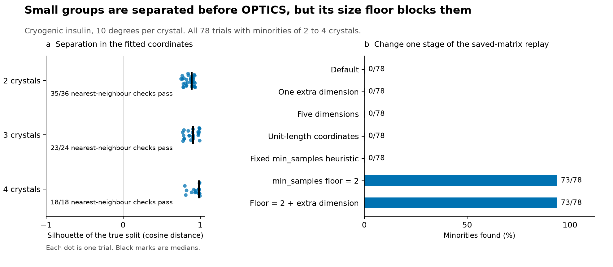

# Small populations in DIALS clustering

Crystallographers group diffraction data before combining them. This public insulin benchmark tests DIALS and a patch for the small populations it misses.

At 10 degrees per crystal, DIALS 3.30.1 finds **0/78 cryogenic minorities of two to four crystals**, although all 78 have positive silhouette scores in the full fitted cosym coordinates and 76/78 pass the nearest-neighbour check. Its full-data empirical `k90` is **five crystals for every cryo species pair**.

On a third collection held out from tuning, **v11 more than doubles minority detection: 58/110 versus 26/110 for DIALS**, with **0/30 false-group trials for both**.



Counts pool tested sizes and rotation ranges; v11 was chosen on the first two collections. Whiskers show nominal 95% intervals ([data](figures/comparison_counts.csv), [interval and false-group caveats](#a-candidate-patch)).

## What was measured

The benchmark uses the public insulin data from [Thompson et al. (2025)](https://doi.org/10.1107/S2059798325004589): 36 cryogenic crystals, 75 labelled room-temperature crystals, and a further 16-crystal collection held out for the final candidate. Mixtures vary the minority size and rotation range per crystal. Trials share crystals and majorities. [Data and licences](SOURCES.md).

A minority counts as found when a reported cluster contains at least two and at least half its members, and they outnumber other members. A false group means two or more clusters in a single-species trial. Such splits can reflect real variation within a species, rather than noise.

At full data, DIALS's empirical `k90` is five crystals for each cryo species pair, and five, five and eight for room-temperature bovine-human, bovine-porcine and human-porcine. `k90` is the smallest tested size found in at least 90% of draws at that and every larger tested size. [Limits at every wedge](FINDINGS.md#f2-the-limit-of-todays-dials).

In full-data insulin mixtures, small populations can be separated in the cosym coordinates yet absent from the automatic clusters. In DIALS 3.30.1, the OPTICS `min_samples` search starts at five. Lowering that floor recovers small groups, but also splits crystals of one species into extra groups.



Each dot is one trial. These diagnostics use the full fitted coordinates, not a 2D projection.

A nearest-neighbour check passes when every minority crystal's closest neighbour is also in the minority. The floor change takes detection from **0/78 to 73/78** at 10 degrees per crystal. Across the replayed cryo single-species trials, it also takes false groups from **0/184 to 104/184**. At room temperature, the corresponding full-data detection rises from 0/156 to 72/156, with false groups rising from 0/9 to 5/9. [Counts](figures/cause_counts.csv), [coordinate diagnostics](figures/coordinate_diagnostics.csv), [replay details](FINDINGS.md#f3-the-cause-opticss-minimum-cluster-size).

This supports manual inspection of the labelled plots. Extra dimensions and unit-length coordinates do not recover these full-data cryo minorities with the floor intact. `outlier_rejection=False` was not directly tested. At shorter wedges, coordinate separation also degrades.

## A candidate patch

The [v11 patch](dials-patch/squashed/correlation-find-small-groups.patch) tests groups in the pairwise correlation matrix after OPTICS. It compares their agreement with counting noise and with structure within the remaining crystals, then admits small groups under additional strength and precision checks.

The comparison's whiskers are nominal 95% Clopper-Pearson intervals over trials that reuse crystals, not uncertainty bounds for independent collections. The third collection's false-group test is weak: even v6, which failed on room temperature, reports 0/30 there. The nominal 95% upper bound for 0/30 is about 12%.

According to the [amendments](PREREGISTRATION.md) and [evidence summary](REPORT.md#evidence), v11's rules were chosen on the cryo and room-temperature collections and fixed before any third-collection trial or judged procedure ran. Before that freeze, the third collection had been processed and its correlations with labelled room-temperature crystals used to swap the species labels of its two batches of eight. The holdout chronology rests on these records; the original commit history is not included.

These are species differences, not ligand binding. A useful next test would have independently known ligand-bound or other subtly different crystals, plus enough controls to expose false splits. The analysis also leaves 23 cryo and six room-temperature minorities separable under its diagnostic criteria but missed by v11. Its estimated data limits depend on those criteria, not a proof that no better method exists. [Open questions](REPORT.md#what-remains-open).

## Reproduce or try the patch

Regenerate the figures directly from the included records:

```bash
python3 -m pip install numpy scipy matplotlib Pillow
python3 figures/make_figures.py
```

The script writes PNG, SVG, CSV and an input-checksum manifest into `figures/`. It does not rerun diffraction processing.

`bash reproduce.sh report` regenerates the full reports from the records without DIALS or raw images. It rewrites the report documents. [Reproduction instructions](REPRODUCTION.md) cover the pinned environment and the full experiment, which downloads about 71 GB of images.

For DIALS developers: [patch instructions and parameters](dials-patch/README.md). After applying the patch to 3.30.1, enable `significant_clusters.find_small_groups=True`. The recorded correlation and regression suite has 48 passes. In 72 sampled end-to-end trials, v11 adds no failures beyond the baseline, but agrees with saved-array scoring in 71/72 outcomes. An inherited dataset-name mapping issue remains at short wedges ([F9](FINDINGS.md#f9-a-defect-of-todays-dials-names-shifted-when-cosym-drops-a-data-set)).

[Findings](FINDINGS.md) | [Full report](REPORT.md) | [Definitions and amendments](PREREGISTRATION.md) | [Provenance](PROVENANCE.json)
